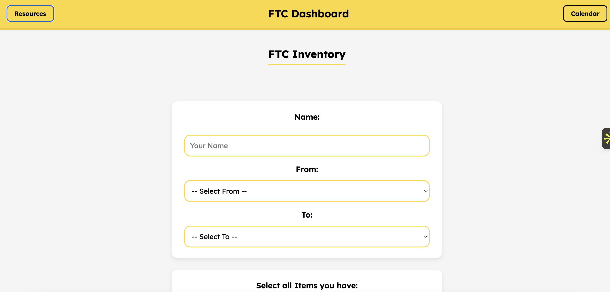
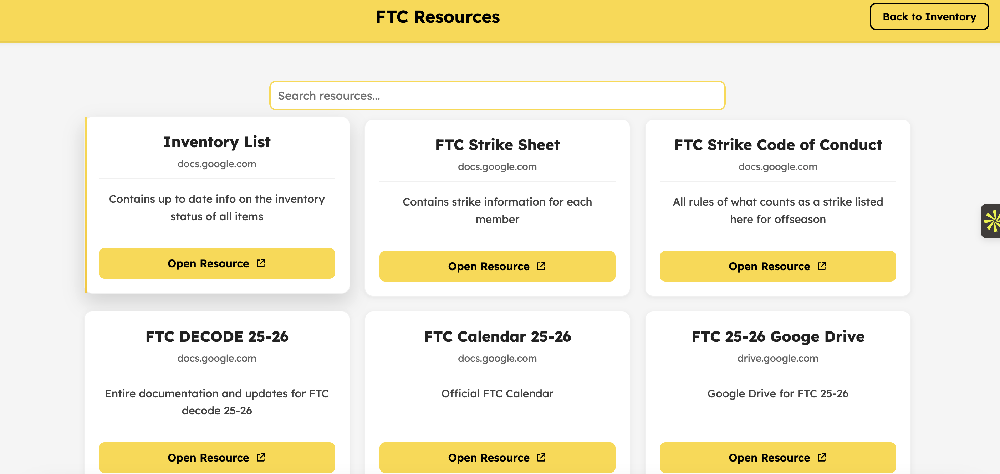
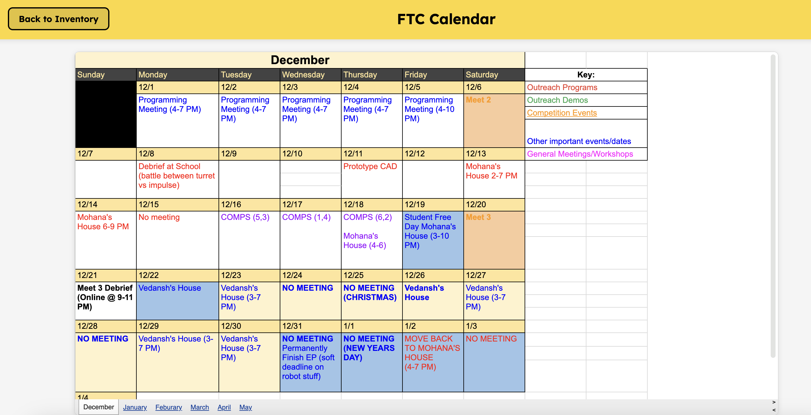

# FTC Inventory

React + Vite app for tracking FTC team parts, handoffs, resources, and calendar events.

Your team can build fast. It should not have to guess where the parts are.

Until now.

```bash
npm install
npm run dev
```

Open the local URL Vite prints, choose who has the parts, where they are moving from, where they are going, and submit the transfer.

No spreadsheets to manually chase. No group-chat archaeology. No "who has the motors?" at 11 PM.

## Preview







## Why

FTC teams move hardware constantly: school, houses, outreach events, meetings, scrimmages, and competition prep. A spreadsheet can hold the truth, but it is awkward for quick updates and easy to forget.

FTC Inventory gives the team a clean front door for the workflow:

- record who is moving items
- choose the source and destination
- search the part list
- enter quantities
- validate stock before submission
- submit directly to the team's Google Sheet
- jump to resources and calendar from the same dashboard

The spreadsheet stays the source of truth. The app makes it usable.

## What The Team Sees

```text
FTC Dashboard

Name:      Mohnish
From:      School
To:        Mohana's House

Select all Items you have:
  [x] GoBilda motor             Qty: 2
  [x] Servo extension wire      Qty: 4
  [ ] Control Hub

Submit Transfer
```

If the selected location does not have enough stock, the form catches it before the transfer is submitted.

```text
GoBilda motor: only 1 available at 'School', cannot move 2.
```

## Quick Start

```bash
# Install dependencies
npm install

# Start the local dev server
npm run dev

# Build for production
npm run build

# Preview the production build
npm run preview
```

## Features

| Feature | What it does |
| --- | --- |
| Inventory transfer form | Records member name, source, destination, selected parts, and quantities |
| Live item list | Pulls the item names from a published Google Sheet CSV |
| Stock validation | Checks selected quantities against the inventory summary before submit |
| Search | Filters parts and resources as you type |
| Resources page | Loads team docs, drive links, strike sheets, and other references from Google Sheets |
| Calendar page | Embeds the published FTC calendar sheet |
| Auto-refresh | Refreshes inventory and resource data every 30 seconds |
| Google Apps Script submit | Posts completed transfer records into the team's sheet workflow |

## How It Works

```text
User opens FTC Dashboard
       |
       v
React app fetches inventory CSV
       |
       v
Team member chooses From / To / parts / quantities
       |
       v
Client validates available stock
       |
       v
Hidden form posts to Google Apps Script
       |
       v
Google Sheet receives the transfer record
```

The app reads public CSV exports from Google Sheets for inventory and resources. It submits transfer records through a Google Apps Script endpoint, keeping the app lightweight and deployable as a static site.

## Data Sources

| Data | Source |
| --- | --- |
| Inventory item list | Published Google Sheet CSV |
| Inventory location summary | Published Google Sheet CSV |
| Resources | Published Google Sheet CSV |
| Calendar | Published Google Sheet iframe |
| Transfer submissions | Google Apps Script web app |

## Project Structure

```text
.
├── assets/
│   ├── calendar.png
│   ├── dashboard.png
│   └── resources.png
├── src/
│   ├── App.jsx
│   ├── index.jsx
│   └── styles.css
├── dist/
├── index.html
├── package.json
└── vite.config.ts
```

## Commands

| Command | Purpose |
| --- | --- |
| `npm run dev` | Start the Vite development server |
| `npm run build` | Build the static production bundle |
| `npm run preview` | Preview the production bundle locally |
| `npm run deploy` | Build and publish `dist/` with `gh-pages` |

## Deployment

The app is configured for GitHub Pages deployment.

```bash
npm run deploy
```

The configured homepage is:

```text
https://ftc.whitneyrobotics.org/
```

## Tech Stack

- React 18
- Vite 5
- Google Sheets published CSV feeds
- Google Apps Script form submission
- GitHub Pages via `gh-pages`

## Requirements

- Node.js 18+
- npm
- Published Google Sheets for inventory, resources, and calendar
- A deployed Google Apps Script endpoint for submissions

## What This Is Not

Not a full warehouse system. It is intentionally small and fast for FTC team logistics.

Not a replacement for the spreadsheet. The spreadsheet remains the source of truth.

Not a private backend. The current app is static and depends on published sheet URLs plus Apps Script.

## Contributing

Keep changes focused on making inventory updates easier for the team. Good PRs improve reliability, mobile usability, validation, accessibility, or the clarity of the data flow.

Before shipping:

```bash
npm run build
```

## License

No license file is currently included.
